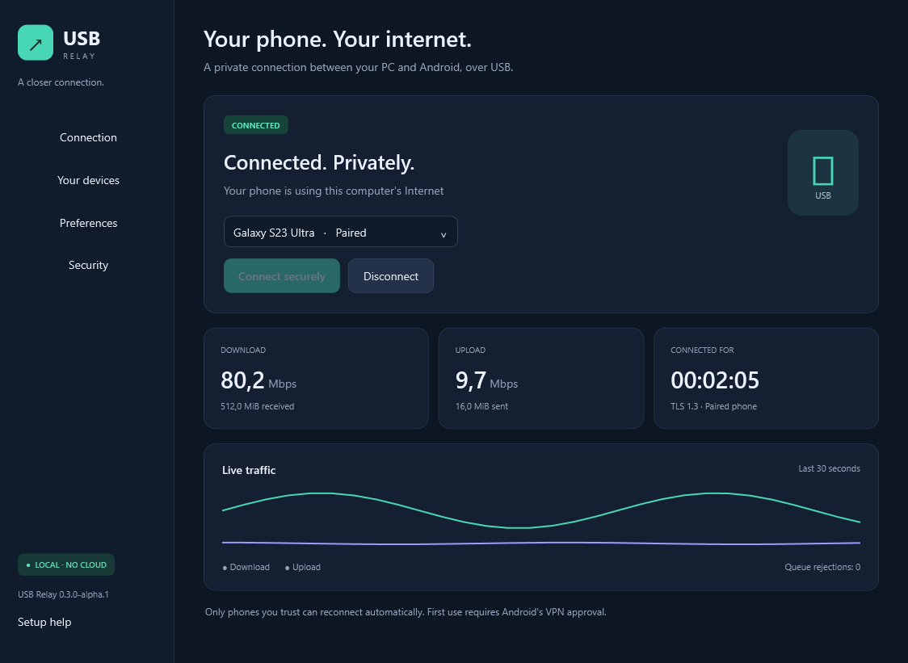

# USB Relay — Android USB Reverse Tethering for Windows

**Share your Windows PC's internet connection with an Android phone over USB. No root or Wi-Fi hotspot required.**

[Project website](https://enesoglu.github.io/android-usb-reverse-tethering/) · [Download the Windows app](https://github.com/enesoglu/android-usb-reverse-tethering/releases) · [Step-by-step installation](docs/INSTALLATION.md) · [Troubleshooting](docs/INSTALLATION.md#troubleshooting) · [Security](SECURITY.md) · [GPLv3 license](LICENSE)

[](https://github.com/enesoglu/android-usb-reverse-tethering/actions/workflows/ci.yml)


USB Relay is a free, open-source **reverse tethering** app: use your computer's Ethernet or Wi-Fi internet on your Android phone through a data-capable USB cable. It is useful for **internet over USB**, **PC-to-Android internet sharing**, and **Ethernet-to-Android connectivity** when the phone's Wi-Fi is unavailable or unreliable.

> **Public alpha:** connection and security checks have passed on a Galaxy S23 Ultra / Android 17. Throughput work is unfinished. A receiver-hashed 512 MiB VPN test reached about **128 Mbps**, while raw ADB on the same setup reached **268–273 Mbps**. Gigabit performance is not claimed. [Measurement details](docs/verification.md).


*Interface preview with sample device and traffic data; the displayed rates are not benchmark claims.*

## Download and connect

1. Open [Releases](https://github.com/enesoglu/android-usb-reverse-tethering/releases) and download the **Windows x64 Setup.exe**. Use the portable ZIP if you prefer not to install.
2. Run setup, then open **USB Relay**. The Windows runtime is included; you do not need Android Studio, Java, Python, Go, or a separate .NET installation.
3. Follow **Setup help** to obtain Google platform tools or select an existing `adb.exe`.
4. On the phone, enable **Developer options → USB debugging**, connect the cable, unlock it, and approve your computer.
5. Select the phone on Windows and click **Trust & connect**. The Windows app installs the Android companion automatically.
6. On Android, tap **Connect securely** and approve the system VPN prompt the first time.

**[Read the complete computer-and-phone guide →](docs/INSTALLATION.md)** It covers Samsung settings, USB authorization, VPN approval, startup, reconnect, updates, uninstalling, and common problems. An offline `START-HERE.html` guide is also included in every Windows package.

## Everyday features

- Native Windows desktop app with a live traffic display and paired-device list.
- Optional **Start with Windows**, **Start minimized to the system tray**, minimize-to-tray, and close-to-tray behavior.
- Automatic reconnect for previously trusted phones, including USB detach/reattach.
- Explicit first pairing and changed-key protection; a serial number alone does not establish trust.
- Rootless Android VPN with TLS 1.3 mutual authentication.
- Automatic companion installation and update from the verified desktop bundle.
- Optional, consent-gated Google platform-tools download with a pinned SHA-256.
- Per-user Windows installation and a self-contained portable alternative.

## Reverse tethering, USB tethering, and hotspot sharing

| Term | Direction | Supported here? |
| --- | --- | --- |
| USB reverse tethering / internet over USB | Computer internet → Android phone | Yes |
| Ordinary USB tethering / mobile-data sharing | Phone mobile data → computer | No; use Android's built-in USB tethering |
| Wi-Fi or mobile hotspot | Phone internet → nearby Wi-Fi devices | No; this app is a cable-based hotspot alternative for the opposite direction |
| USB file transfer / MTP | Files between devices | No; this project shares an internet connection |

Do **not** enable Android's USB tethering switch for this app. Your computer must already have a working internet connection. Ethernet is useful but not mandatory.

## Frequently asked questions

### How do I share Windows PC internet with Android over USB-C?

Install USB Relay on Windows, enable Android USB debugging, authorize the PC, and choose **Trust & connect**. The desktop installs the companion APK. Approve Android's VPN prompt on the phone. Follow the [complete installation guide](docs/INSTALLATION.md) for each screen.

### Can I use Ethernet internet on my phone without Wi-Fi or root?

Yes. The computer can use Ethernet or Wi-Fi, and the phone receives that connection over a data-capable USB-A or USB-C cable. Root is not required. USB-C alone does not guarantee a particular data rate.

### Is USB Relay a free Tetrd alternative or a Gnirehtet GUI?

USB Relay is a free GPLv3 Windows reverse-tethering alternative with its own Go/gVisor backend and Android companion. It does not wrap Gnirehtet. It is an early public alpha with a smaller test matrix; compare the documented limits before choosing it.

### Can it replace my mobile hotspot or share phone data with a PC?

It shares **PC internet to Android**. For the other direction, use Android's built-in USB tethering or hotspot. USB Relay does not share files, unlock mobile-data plans, or combine phone and PC bandwidth.

### Will my gigabit connection reach gigabit speeds on Android?

No such guarantee is made. The verified encrypted VPN result is about 128 Mbps on the documented setup. Cable negotiation, ADB, encryption, packet processing, and device load can limit throughput. Faster transport is ongoing work.

### Will a paired phone reconnect automatically?

Yes, after initial pairing and Android authorization, a trusted phone can reconnect when USB returns. Windows startup and tray options are available. Android permission revocation, force-stop, OEM power policies, or another VPN can require action on the phone.

## Alternatives compared

This feature comparison uses upstream documentation, checked on 2026-11-16. It is not a speed or reliability ranking; third-party wrappers may add their own interfaces.

| Feature | USB Relay | Gnirehtet | Tetrd | SimpleRT |
| --- | --- | --- | --- | --- |
| Open-source license | GPL-3.0-only | Apache-2.0 | No public source license identified | GPL-3.0-or-later |
| Cost | Free | Free | Free trial, then paid options | Free |
| Rootless Android | Yes | Yes | Yes | Yes |
| Windows desktop | Native GUI | Official CLI | Desktop application | Windows support under research |
| Initial setup | Guided; Android USB/VPN approvals | ADB and command/script | Desktop + Android setup | Console / system networking setup |
| USB debugging | Required | Required | Required on Windows | Not required |
| Platform focus | Windows x64 | Windows, Linux, macOS | Windows, Linux, macOS | Linux, macOS |
| Current caution | Public alpha; limited device testing | Upstream says not actively maintained | Commercial terms apply | Check upstream platform requirements |

Sources: [Gnirehtet README](https://github.com/Genymobile/gnirehtet), [Tetrd developer listing](https://play.google.com/store/apps/details?id=com.robskie.tether&hl=en), [SimpleRT README](https://github.com/robinpaulson/SimpleRT). Android security approvals mean none should be advertised as permission-free one-click setup.

If you are looking for a **gnirehtet GUI** or a **Tetrd alternative**, this is an independent early-stage project with its own implementation. The alpha performance limits below remain important.

## Requirements and current limits

- Windows x64; tested on Windows 11. Windows 10 is not part of the verified device matrix. ARM64-native, Linux, macOS, and iPhone builds are not provided.
- Android 10 or newer, a data-capable cable, and USB-debugging authorization. Some Windows devices need an official OEM ADB driver.
- One active phone. On Windows backends without USB device-path reporting, connect only one Android USB device to avoid ambiguous selection.
- IPv4 TCP and UDP. General IPv6 forwarding and ICMP/ping are not implemented.
- Android allows one active VPN per profile; this connection replaces another phone VPN.
- Some apps require a Wi-Fi/cellular transport even when a VPN provides working internet.
- Windows downloads are currently **not Authenticode-signed**. Verify the repository and release checksums; never disable antivirus or organization policies to run them.

The app installs no network adapter, changes no Windows routing or Internet Connection Sharing settings, and does not require administrator rights for its own per-user installation. An optional OEM USB driver is separate and may require administrator approval.

## Security and privacy

The USB tunnel uses TLS 1.3, pinned public keys, and a fresh session nonce. Windows protects identity and pairing files with current-user DPAPI; Android keeps its client key in Keystore. PC-local and private-network destinations are blocked by default. The app has no telemetry, accounts, cloud relay, or advertising.

This is **not an anonymity VPN**: phone traffic leaves through the computer's internet connection. Android may fall back to Wi-Fi or mobile data after disconnection unless you configure and verify its **Always-on VPN / Block connections without VPN** policy. No independent audit or certification is claimed. See the [threat model](docs/security.md), [privacy notes](PRIVACY.md), and [security reporting policy](SECURITY.md).

Google platform tools are **not mirrored in this repository or bundled in releases**. The setup assistant downloads the pinned archive directly from Google only after explicit SDK-terms consent. You can use an existing trusted `adb.exe` instead. [Distribution notes](docs/distribution-research.md).

## Build, contribute, and reproduce

See [CONTRIBUTING.md](CONTRIBUTING.md) for tool versions, build commands, tests, Android package variants, and signed-release automation. End users should download a release rather than build from source.

```powershell
powershell -NoProfile -ExecutionPolicy Bypass -File ./check.ps1
powershell -NoProfile -ExecutionPolicy Bypass -File ./build-desktop.ps1
```

Contributions and reproducible issue reports are welcome. Please provide synthetic diagnostics, not phone serial numbers, private keys, packet captures, or browsing data. [Report a bug](https://github.com/enesoglu/android-usb-reverse-tethering/issues/new/choose).

[Publication and discoverability report](docs/PUBLICATION-REPORT.md): completed distribution work, external submissions, verification and remaining owner steps.

## Roadmap

1. Improve sustained VPN throughput and profile the Go/TLS/Android TUN path.
2. Expand screen-off, long-duration, QUIC, Windows, and Android device testing.
3. Add trusted Windows code signing and package-manager distribution after the installer stabilizes.
4. Evaluate AOA/WinUSB or a virtual-adapter transport through measurements, not assumed speed guarantees.
5. Improve multi-device USB selection and evaluate IPv6/ICMP with matching security tests.

## License

Copyright 2026 USB Relay contributors. **GNU GPL version 3 only (GPL-3.0-only)**; no warranty. Source and build instructions are provided alongside each binary release. Dependencies retain their own compatible licenses and notices; see [THIRD_PARTY_NOTICES.md](THIRD_PARTY_NOTICES.md) and `third_party/`.

This is an independent implementation using gVisor netstack and Android VpnService. It is not affiliated with Google, Samsung, Genymobile/gnirehtet, or Tetrd, and does not include their commercial application engines.
